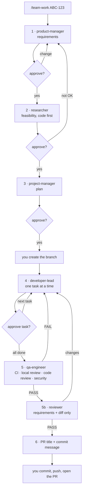
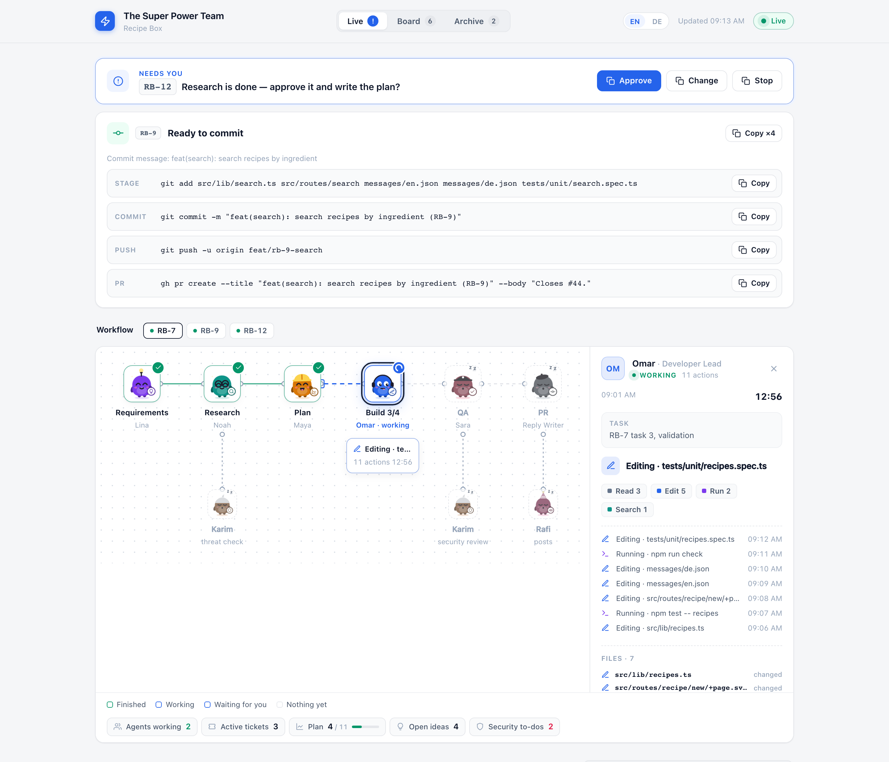

<p align="center">
  <picture>
    <source media="(prefers-color-scheme: dark)" srcset="assets/mark-dark.svg">
    <source media="(prefers-color-scheme: light)" srcset="assets/mark-light.svg">
    
  </picture>
</p>

<h1 align="center">The Super Power Team</h1>

<p align="center"><strong>An agent team for Claude Code that takes a ticket from idea to pull request — while you stay in the driver's seat.</strong></p>

<p align="center">
  
  <a href="https://www.npmjs.com/package/the-super-power-team"></a>
  
  <a href="LICENSE"></a>
</p>

<p align="center">
  <a href="#quick-start">Quick start</a> |
  <a href="#the-workflow">Workflow</a> |
  <a href="#live-dashboard">Dashboard</a> |
  <a href="#command-map">Commands</a> |
  <a href="CHANGELOG.md">Changelog</a> |
  <a href="https://github.com/al-shaikhli-w/Pit-Crew/issues">Issues</a>
</p>

The Super Power Team gives Claude Code a crew of eight specialised agents — product
manager, researcher, project manager, developer lead, QA engineer, independent
reviewer, reply writer and agent maintainer. They work one ticket at a time,
step by step, and stop after every step for your approval. Requirements, plans,
QA evidence and the shared brief stay as readable files in your project instead
of disappearing with the chat.

You drive. The crew works fast between your stops. Nobody in the crew commits,
pushes or posts — you do.

It works with any stack, on Windows, macOS and Linux, and in English, Deutsch,
العربية or any language you choose.

Start with the [Quick start](#quick-start) below.

## At a glance

| | |
| --- | --- |
| **What it is** | A Claude Code plugin: eight agents, eleven commands, a live dashboard. |
| **What it does** | Takes one ticket from idea → requirements → plan → code → QA → review → pull request. |
| **Who decides** | You. The team stops after every step and waits for approve, change or stop. |
| **What it never does** | Commit, push, open PRs, or write to your tracker. You run every git command yourself. |
| **Where it keeps its work** | Plain markdown files in `.claude/team/` inside your project. |
| **Trackers** | Linear, Jira, Notion, GitHub Issues, any connected tool, or a local board. |
| **Runs on** | Windows, macOS, Linux — terminal, desktop app or IDE extension. |
| **Install** | `npx the-super-power-team` |
| **Update** | `npx the-super-power-team@latest` |
| **npm** | [`the-super-power-team`](https://www.npmjs.com/package/the-super-power-team) |
| **License** | MIT |

## Table of contents

1. [Why use it?](#why-use-it)
2. [Quick start](#quick-start)
3. [The workflow](#the-workflow)
4. [Parallel work](#parallel-work)
5. [Live dashboard](#live-dashboard)
6. [What do you need?](#what-do-you-need)
7. [Command map](#command-map)
8. [The team](#the-crew)
9. [Tickets](#tickets)
10. [File-backed project state](#file-backed-project-state)
11. [Review and verification](#review-and-verification)
12. [Rolling back](#rolling-back)
13. [Tool support](#tool-support)
14. [Status and updates](#status-and-updates)
15. [Support and contributing](#support-and-contributing)

## Why use it?

AI coding gets unreliable when the ticket, the plan and the proof live only in
one long chat, and when "done" or "tested" is not backed by output.

The Super Power Team adds a controlled loop:

- **One role per step.** A product manager writes requirements, a researcher
  checks feasibility in the code first, a project manager plans, a developer
  lead builds, a QA engineer verifies. Each one has its own instructions and
  limits.
- **You approve every step.** Approve, change or stop — a yes covers one step,
  never the next.
- **A shared brief.** Agents never see each other's conversations. One page per
  ticket, `00-brief.md`, keeps them in the same direction: the goal, your
  decisions, the constraints and the notes they leave for each other.
- **Proof before PASS.** QA runs the CI gate, the local review, a code review
  and a security review, and reports PASS only with the output that proves it.
- **Fresh eyes.** After QA, an independent reviewer who sees only the
  requirements and the diff checks the work again.
- **Your git, your tracker.** The crew hands you every git command instead of
  running it, and reads Linear, Jira, Notion or GitHub without ever writing to
  them. Replies to review comments are drafts for you to post.
- **Watch it live.** A local dashboard shows which agent works on what, step by
  step, as it happens.

The point is not to remove your judgment. It is to keep it at every step while
the crew does the work.

## Quick start

**Requirements:**

| You need | Why |
| --- | --- |
| [Node.js](https://nodejs.org/) 18 or newer | Runs the one-line installer (`npx`). |
| [Claude Code](https://claude.com/claude-code) | Terminal, desktop app or IDE extension. Cloud sessions do not load local plugins. |
| `bash` | Runs the dashboard hooks. On Windows: Git for Windows, which Claude Code normally uses anyway. |
| [`gh`](https://cli.github.com/) signed in | Only for pull-request rounds (`/team-work pr`). |

### 1. Install

Run this in any terminal:

```bash
npx the-super-power-team
```

That is the whole install. The installer:

1. copies the plugin to `~/.claude/the-super-power-team/`;
2. registers it with Claude Code as `team@the-super-power-team`;
3. tells you what to do next.

No git, no GitHub account and no `/plugin` commands needed.

<details>
<summary>The <code>claude</code> command is not on your PATH?</summary>

The installer still copies the files, then prints two commands. Paste them
into Claude Code:

```text
/plugin marketplace add ~/.claude/the-super-power-team
/plugin install team@the-super-power-team
```

</details>

### 2. Set up your project

Start a new Claude Code session in your project, then set it up once:

```text
/team-setup
```

Setup asks one question at a time, in your language:

1. **Reply language** — the crew speaks it from then on. Code, commits and PR
   titles always follow the project.
2. **Agents per ticket** — one at a time (cheaper) or several in parallel
   (faster on big tickets).
3. **Tickets** — Linear, Jira, Notion, GitHub Issues, another connected tool,
   only here, or none — and whether to keep a local board too.
4. **Independent review** and the **live dashboard**.
5. **The project** — with code, the researcher reads it and writes
   `project-tech.md`; without code, a short interview turns your idea into
   `project-info.md`. Either way you get `project-plan.md`, the features in
   order. You approve each document.
6. **Branch names, CI command and git** — whether the crew's files stay local,
   are shared, or are committed. It writes only ignore lines.
7. **Doctor** — a quick check that ends with one line, or with the problems and
   their fixes.

Then start working:

```text
/team-work
```

You get today's list. Pick a row, or name a ticket: `/team-work ABC-123`.

> Claude Code asks before every write under `.claude/`, also in accept-edits
> mode, and a permission rule cannot change that. Expect a few approval prompts
> while the crew saves its step files.

## The workflow

Learn these three commands first:

```text
/team-work <ticket> -> /team-work pr -> /team-status
```



Every diamond is a stop. Each step has a narrow job:

| Step | Who | Saved as | You do |
| --- | --- | --- | --- |
| 1 Requirements | product-manager reads the ticket, comments, linked tickets | `01-requirements.md` | approve |
| 2 Feasibility | researcher reads the code, runs existing tests | `02-research.md` | approve |
| 3 Plan | project-manager splits the work into tasks | `03-plan.md` | approve |
| — Branch | the coordinator gives you the commands | noted in `03-plan.md` | run them, say "done" |
| 4 Build | developer-lead, one task at a time | `04-implementation.md` | approve each task |
| 5 QA | qa-engineer runs the four checks | `05-qa.md` | read the verdict |
| 5b Independent review | reviewer, who never saw the plan, the build or QA's report | `05b-review.md` | pick which findings to fix |
| 6 Hand-over | the coordinator | `06-pr.md` | commit, push, open the PR |
| 7 PR rounds | `/team-work pr` — QA reads new comments and checks | `07-pr-rounds.md` | approve the fixes, post the drafted replies |

When the PR is merged or closed, the ticket moves to
`.claude/team/work/history/` with one line in `history/INDEX.md`.

The **branch name** follows your tracker's own branch name for the ticket, or a
pattern such as `<user>/<ticket>-<slug>`. The crew never creates it; it gives
you the commands for your shell.

## Parallel work

At the start of a ticket the crew asks: **one agent at a time** or **several in
parallel**. With several, the researcher reads the code while the requirements
are written, build tasks that touch different files run at the same time, and
the four QA checks run side by side. Approvals never run in parallel — you
still decide after every step.

## Live dashboard

See every agent, every ticket and everything that waits for you in one page in
your browser. It refreshes every 4 seconds, works offline, and needs no server
or install.



```text
/team-dashboard
```

| View | What it shows |
| --- | --- |
| **Needs you** | The crew's open question with Approve, Change and Stop buttons that copy your answer. |
| **Ready to commit** | The commit message and every command — stage, commit, push, PR — each with a copy button. The page never runs anything. |
| **Workflow** | Each ticket's steps as connected nodes; the running agent glows with what it does this second. Click a step for its agent's panel: task, timer, every step, files changed and read, and its final report. |
| **Timeline** | The last 30 minutes as bars, or Today, Week, Sprint and All projects as a heat map per agent. |
| **Tickets** | What is in progress, the list for Today, Week or Sprint, and what is next on the plan — each with a Start button. |
| **Board** | Your local tickets in four columns: Plan, Do, Check, Done. |
| **Archive** | Every finished ticket with result, PR, days and a summary, with search and filters. |

Live events come from the plugin's hooks: every agent start, step and finish,
with no approval prompt. Only file names, command descriptions, web domains and
tool names are recorded — no paths, file contents, full commands or secrets —
and only while the dashboard is on. `/team-dashboard off` stops it.

## What do you need?

| What you want | Start here |
| --- | --- |
| "What should I do today?" | `/team-work` (or `week`, `sprint`) |
| "Work this ticket." | `/team-work ABC-123` |
| "Build this idea — there is no ticket." | `/team-work "export recipes as CSV"` |
| "Reviewers left comments on my PR." | `/team-work pr` |
| "Get a second opinion on this change." | `/team-work review` |
| "Where does everything stand?" | `/team-status` |
| "Add a ticket to the board." | `/team-ticket new` |
| "Undo a ticket we shipped." | `/team-rollback ABC-123` |
| "Keep this idea for later." | `/team-new-idea add CSV export` |
| "Something feels off with the setup." | `/team-doctor` |
| "I updated the plugin." | `/team-update` |

## Command map

### Work

| Command | Purpose |
| --- | --- |
| **/team-work** | Today's list; with `week` or `sprint`, a longer horizon. |
| **/team-work `<ticket>`** | Work a ticket step by step; it resumes at the first unapproved step. |
| **/team-work `"<idea>"`** | Work an idea without a ticket. |
| **/team-work pr** | One review round on the open PR: comments, failed checks, fixes, drafted replies. |
| **/team-work review** | An independent review of the current work, now. |

### Tickets and ideas

| Command | Purpose |
| --- | --- |
| **/team-ticket** | The local board: `new` (written here, or taken from Linear, Jira, Notion, GitHub…), `list`, `move`, `wait`, `go`. |
| **/team-new-idea** | Keep a wish for later; `review` lets the project manager step back and propose what goes into the plan. |
| **/team-rollback** | Safely undo a shipped ticket: risk check, reverse change on a new branch, QA, review, PR. |

### Understand

| Command | Purpose |
| --- | --- |
| **/team-status** | A waterfall of every active ticket, the plan's progress and the open ideas. |
| **/team-dashboard** | The live page in your browser; `off` stops it. |
| **/team-doctor** | A quick setup check; `fix` walks through the problems. |

### Set up and maintain

| Command | Purpose |
| --- | --- |
| **/team-setup** | Set up the crew in a project, once. |
| **/team-update** | Bring this project's crew files up to the installed plugin version; `check` only shows the changes. |
| **/team-names** | Give agents personal names — "Maya, plan RB-12". |
| **/team-new-agent** | Add your own agent, joining the workflow at the step you choose; `list` and `remove` too. |
| **/team-work sync** | Check the project profile against the project's current rules and scripts. |

## The crew

| Agent | Job | Edits files | Internet |
| --- | --- | --- | --- |
| `team:product-manager` | Today's list, requirements, triage of PR problems, final review | No | Yes |
| `team:researcher` | Feasibility check (code first), docs and tool research | No | Yes |
| `team:project-manager` | Splits the work into tasks, writes the plan | Only the plan | Yes |
| `team:developer-lead` | Builds the approved plan with tests | Code + tests | No |
| `team:qa-engineer` | CI, local review, code review, security review; reads PR comments | Tests + its reports | No |
| `team:reviewer` | Independent review after QA: sees only the requirements and the diff | No | No |
| `team:reply-writer` | Drafts replies to PR, GitHub and tracker comments in your style | No | No |
| `team:agent-maintainer` | Keeps the project profile up to date | `.claude/team/team.md` only | No |

Need a design reviewer, an accessibility checker or a performance auditor?
`/team-new-agent` writes one with the crew's safety rules built in and lets it
join at the step you choose.

## Tickets

The Super Power Team reads tickets from **Linear, Jira, Notion, GitHub Issues** or any tool
with a connector — and never writes to them. It can also keep its own **local
board**, alone or next to your tracker:

| Plan | Do | Check | Done |
| --- | --- | --- | --- |
| written down; requirements and plan not approved yet | being built | QA, independent review, PR open | merged or closed |


`/team-ticket new` first asks where the ticket comes from:

1. **New, written here** — it gets your prefix, e.g. `RB-12`, and lives only on
   the board.
2. **From your tracker or another platform** — give its id or link. The crew
   reads it there, keeps its id, fills the card from it and links back to it.

While a ticket is worked, the crew moves it by itself — Plan, Do, Check, Done —
and marks it **waiting** when it stops for your answer. For a ticket from a
platform only the board moves; its status there stays yours to change.

## File-backed project state

Everything lives under `.claude/team/` in your project:

| File | Purpose |
| --- | --- |
| `team.md` | Project facts: languages, commands, tracker, branch names, review tool, names. |
| `project/project-info.md` | The idea, users and goals — in your words. |
| `project/project-tech.md` | Stack, structure, commands and risks — read from the code, or proposed. |
| `project/project-plan.md` | The features in order. |
| `ideas/idea-v<N>.md` | Wishes not planned yet. |
| `tickets/<ID>.md` | The local board, when it is on. |
| `work/active/<ticket>/` | One file per step, plus `00-brief.md`. |
| `work/history/` | Finished tickets and `INDEX.md`. |

```text
.claude/team/
├── team.md
├── project/      project-info.md · project-tech.md · project-plan.md
├── ideas/        idea-v1.md (closed) · idea-v2.md (open)
├── tickets/      RB-12.md · ABC-41.md
└── work/
    ├── active/abc-123/   00-brief.md · 01-requirements.md · … · 07-pr-rounds.md
    └── history/          INDEX.md · 2026-11-19-abc-123/
```

A redone step gets a new dated section in its file; nothing is deleted. The
coding rules stay in your `CLAUDE.md` — the agents follow it and do not repeat
it.

## Review and verification

| Check | Who | What it proves |
| --- | --- | --- |
| **CI gate** | qa-engineer | The project's full gate passes, with its output. |
| **Local review** | qa-engineer | Your review tool's findings, each checked against the code. |
| **Code review** | qa-engineer | Correctness, regressions, edge cases, project rules, and tests that test behaviour. |
| **Security review** | qa-engineer | No secrets, unescaped input, missing server checks or leaking data. |
| **Independent review** | reviewer | A fresh look with only the requirements and the diff. |
| **PR rounds** | qa-engineer | Every new review comment and failed check: valid, not valid, or already fixed. |

Verdicts are **PASS** (run in this session, with output), **FAIL** (output,
steps, expected vs. actual) or **NOT TESTED** (with the reason). Anything but
PASS goes back to the build.

**The crew always**

- stops after each step until you approve;
- gives you git commands instead of running them;
- treats the tracker and GitHub as read-only — replies are drafts for you to post;
- reports PASS only with the output that proves it;
- answers short: tables and lists, no recap.

## Rolling back

`/team-rollback ABC-123` undoes a shipped ticket without touching git itself:

1. It finds the merged change from the archive and the PR, and you confirm it.
2. The researcher checks later changes to the same files, what depends on the
   ticket, data a revert cannot undo, and whether the reverse patch applies.
3. The project manager plans it on a `revert/<ticket>` branch.
4. From there it is a normal ticket: the developer lead applies the reverse
   change in the working tree, QA and the independent review run, and you
   commit, push and open the PR.

The original ticket's history stays, with one line saying when it was rolled
back.

## Tool support

| | |
| --- | --- |
| **Claude Code** | Terminal, desktop app and IDE extensions. Cloud sessions do not load local plugins. |
| **Systems** | Windows (PowerShell, with Git Bash for the hooks), macOS and Linux (bash or zsh). |
| **Trackers** | Linear, Jira, Notion or any tool through its connector; GitHub Issues through `gh`; or the local board. |
| **Languages** | The crew answers in the language you choose; Arabic pages render right to left. |

## Status and updates

| Task | Command |
| --- | --- |
| **Update to the newest version** | `npx the-super-power-team@latest` |
| **Install a specific version** | `npx the-super-power-team@0.13.0` |
| **See which version you have** | `claude plugin list` |
| **Uninstall** | `npx the-super-power-team uninstall` |
| **Help** | `npx the-super-power-team help` |

After an update, start a new session and run `/team-update` in each project.
It shows what changed — new profile fields, the dashboard page, new sections
for your own agents — and applies only what you approve. Your project
documents and ticket work are never touched. `/team-doctor` warns when the
files are older than the plugin.

Uninstalling removes the plugin and `~/.claude/the-super-power-team/`; the
`.claude/team/` files in your projects stay.

See what changed in each version in the [Changelog](CHANGELOG.md).

### Troubleshooting

| Problem | Fix |
| --- | --- |
| Something does not work | `/team-doctor`, then `/team-doctor fix` |
| `npx` is not found | Install [Node.js](https://nodejs.org/) 18 or newer, open a new terminal |
| `/team-work` is unknown | Run `npx the-super-power-team` again, then start a new session; `claude plugin list` should show `team@the-super-power-team` |
| Commands appear twice | You also have the older GitHub install: `claude plugin uninstall team@my-super-team` |
| An agent cannot read tickets | Connect your tracker (`/mcp`), or set it to `GitHub Issues` or `none` in `.claude/team/team.md` |
| An agent uses an old command or path | `/team-work sync` |
| Crew files show up in `git status` | Run `/team-setup` again and choose a git option, or add `.claude/team/` to `.git/info/exclude` |
| You want to stop mid-ticket | Just stop; `/team-work <ticket>` resumes at the first unapproved step |

## Support and contributing

Found a bug or an agent that works from old information? Open an
[issue](https://github.com/al-shaikhli-w/Pit-Crew/issues). Changes are
listed in the [Changelog](CHANGELOG.md).

## License

MIT — see [LICENSE](LICENSE).
