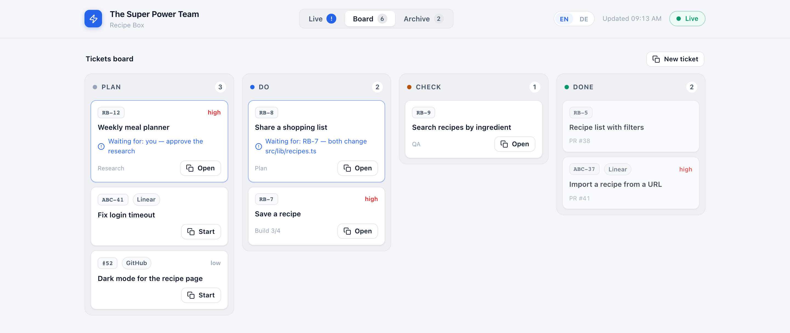

<p align="center">
  
</p>

<h1 align="center">The Super Power Team</h1>

<p align="center"><strong>An agent team for Claude Code that takes a ticket from idea to pull request — while you stay in the driver's seat.</strong></p>

<p align="center">
  
  <a href="https://www.npmjs.com/package/the-super-power-team"></a>
  
  <a href="https://github.com/al-shaikhli-w/the-super-power-team/blob/master/LICENSE"></a>
</p>

<p align="center">
  <a href="#quick-start">Quick start</a> |
  <a href="#the-workflow">Workflow</a> |
  <a href="#live-dashboard">Dashboard</a> |
  <a href="#command-map">Commands</a> |
  <a href="https://github.com/al-shaikhli-w/the-super-power-team/blob/master/CHANGELOG.md">Changelog</a> |
  <a href="https://github.com/al-shaikhli-w/the-super-power-team/issues">Issues</a>
</p>

The Super Power Team gives Claude Code a crew of ten specialised agents — product
manager, researcher, security engineer, project manager, developer lead, QA
engineer, independent reviewer, reply writer, agent maintainer, and Rafi, the
social media manager who tells the world what you shipped. They work a
ticket step by step and stop after every step for your approval — or several
tickets at once, like a real team, with a pool of developers and QA engineers
that grows and shrinks by itself. Requirements, plans,
QA evidence and the shared brief stay as readable files in your project instead
of disappearing with the chat.

You drive. The crew works fast between your stops. Nobody in the crew commits,
pushes or posts — you do.

It works with any stack, on Windows, macOS and Linux, and in English, Deutsch,
العربية or any language you choose.

Start with the [Quick start](#quick-start) below.

## At a glance

| | |
| --- | --- |
| **What it is** | A Claude Code plugin: ten agents, thirteen commands, a live dashboard. |
| **What it does** | Takes a ticket from idea → requirements → security check → plan → code → QA → review → pull request. Up to three tickets build at the same time. |
| **Security** | A security engineer writes `security.md` — your security to-do list — and checks every ticket before and after it is built. |
| **Marketing** | Rafi writes a marketing plan and drafts social media posts for every feature you ship — you publish them. |
| **Saves tokens** | Every agent is a sub-agent with a short brief; simple jobs run on a cheaper model. |
| **Who decides** | You. The team stops after every step and waits for approve, change or stop. |
| **What it never does** | Commit, push, open PRs, or write to your tracker. You run every git command yourself. |
| **Where it keeps its work** | Plain markdown files in `.claude/team/` inside your project. |
| **Trackers** | Linear, Jira, Notion, GitHub Issues, any connected tool, or a local board. |
| **Runs on** | Windows, macOS, Linux — terminal, desktop app or IDE extension. |
| **Install** | `npx the-super-power-team` |
| **Update** | `npx the-super-power-team@latest` |
| **npm** | [`the-super-power-team`](https://www.npmjs.com/package/the-super-power-team) |
| **License** | MIT |

## Table of contents

1. [Explained for kids](#explained-for-kids)
2. [Why use it?](#why-use-it)
3. [Quick start](#quick-start)
4. [The workflow](#the-workflow)
5. [Parallel work](#parallel-work)
6. [Several tickets at once](#several-tickets-at-once)
7. [Security](#security)
8. [Marketing with Rafi](#marketing-with-rafi)
9. [Models and tokens](#models-and-tokens)
10. [Live dashboard](#live-dashboard)
11. [What do you need?](#what-do-you-need)
12. [Command map](#command-map)
13. [The team](#the-crew)
14. [Tickets](#tickets)
15. [File-backed project state](#file-backed-project-state)
16. [Review and verification](#review-and-verification)
17. [Rolling back](#rolling-back)
18. [Tool support](#tool-support)
19. [Status and updates](#status-and-updates)
20. [Support and contributing](#support-and-contributing)

## Explained for kids

Imagine you want to build a big LEGO castle, and you have a team of helpers.
Each helper is good at **one** thing:

| Helper | What they do — like in a LEGO team |
| --- | --- |
| 📋 **Product manager** | Listens to your wish and writes down exactly what the castle needs: "a tower, a gate, a bridge". |
| 🔎 **Researcher** | Looks at the bricks you already have and says: "Yes, we can build that" — or "we are missing blue bricks". |
| 🛡️ **Security engineer** | The castle guard. Checks that no door is left open, no key is lying around, and nobody can sneak in. They keep a list of everything that still needs a lock — that is `security.md`. |
| 🗺️ **Project manager** | Cuts the big job into small steps: "first the wall, then the tower". |
| 🧱 **Developer** | Builds it, one step at a time. |
| ✅ **QA engineer** | Tests everything: does the gate open? does the tower stand? They only say "it works" when they have *seen* it work. |
| 👀 **Reviewer** | A friend who was not there while you built. They look with fresh eyes and spot what everyone else missed. |
| ✉️ **Reply writer** | Writes nice answers when other people leave comments. |
| 🔧 **Agent maintainer** | Keeps the team's notebook up to date. |
| 📣 **Rafi, social media** | When the castle is finished, Rafi tells everyone about it: Rafi writes the posters and the posts ("Come see our new tower!") and makes a plan for who to tell, where and when. Rafi only *writes* them — you decide if they go up on the wall. |

**You are the boss.** After every step the team stops and asks you:
"Is this OK?" You say **yes**, **change it**, or **stop**. Nobody moves on
without your yes.

**Many castles at once.** If you have three castles to build, you do not
want one builder doing them one after another. So the team brings more
builders — up to three — and gives each one **their own table** (a "worktree").
Builders never take bricks from another builder's table. If two castles need
the *same* special brick, the second builder waits until the first one is
done, so nobody fights over it. When there is no more work, the extra
builders go home. Testers work the same way.

**Saving energy.** Every helper costs a bit of energy (we call it "tokens").
Easy jobs, like writing a short reply, go to a quicker helper who uses less
energy. Hard jobs, like building or guarding the castle, go to the strongest
helper.

**Telling the world.** A great castle nobody knows about is a lonely castle.
After every finished piece, Rafi writes the news for you — but never
shares secrets, never talks about unfinished parts, and never posts anything
alone.

**Nobody touches your treasure.** The team never saves, sends or publishes
anything by itself (no `git commit`, no `git push`). It hands you the
commands, and *you* press the button.

## Why use it?

AI coding gets unreliable when the ticket, the plan and the proof live only in
one long chat, and when "done" or "tested" is not backed by output.

The Super Power Team adds a controlled loop:

- **One role per step.** A product manager writes requirements, a researcher
  checks feasibility in the code first, a security engineer checks the risks,
  a project manager plans, a developer lead builds, a QA engineer verifies. Each one has its own instructions and
  limits.
- **You approve every step.** Approve, change or stop — a yes covers one step,
  never the next.
- **A shared brief.** Agents never see each other's conversations. One page per
  ticket, `00-brief.md`, keeps them in the same direction: the goal, your
  decisions, the constraints and the notes they leave for each other.
- **Proof before PASS.** QA runs the CI gate, the local review and a code
  review; the security engineer runs the security review. PASS only comes with
  the output that proves it.
- **Security from day one.** On a project with code, setup writes
  `security.md`: what the system protects, where its doors are, and a security
  to-do list you can read and fix item by item.
- **A real team.** Several tickets at once, each on its own git worktree, with
  developers and QA engineers added and removed as the work needs them.
- **Fresh eyes.** After QA, an independent reviewer who sees only the
  requirements and the diff checks the work again.
- **Your git, your tracker.** The crew hands you every git command instead of
  running it, and reads Linear, Jira, Notion or GitHub without ever writing to
  them. Replies to review comments are drafts for you to post.
- **Watch it live.** A local dashboard shows which agent works on what, step by
  step, as it happens.

The point is not to remove your judgment. It is to keep it at every step while
the crew does the work.

## Quick start

**Requirements:**

| You need | Why |
| --- | --- |
| [Node.js](https://nodejs.org/) 18 or newer | Runs the one-line installer (`npx`). |
| [Claude Code](https://claude.com/claude-code) | Terminal, desktop app or IDE extension. Cloud sessions do not load local plugins. |
| `bash` | Runs the dashboard hooks. On Windows: Git for Windows, which Claude Code normally uses anyway. |
| [`gh`](https://cli.github.com/) signed in | Only for pull-request rounds (`/team-work pr`). |

### 1. Install

Run this in any terminal:

```bash
npx the-super-power-team
```

That is the whole install. The installer:

1. copies the plugin to `~/.claude/the-super-power-team/`;
2. registers it with Claude Code as `team@the-super-power-team`;
3. tells you what to do next.

No git, no GitHub account and no `/plugin` commands needed.

<details>
<summary>The <code>claude</code> command is not on your PATH?</summary>

The installer still copies the files, then prints two commands. Paste them
into Claude Code:

```text
/plugin marketplace add ~/.claude/the-super-power-team
/plugin install team@the-super-power-team
```

</details>

### 2. Set up your project

Start a new Claude Code session in your project, then set it up once:

```text
/team-setup
```

Setup asks one question at a time, in your language:

1. **Reply language** — the crew speaks it from then on. Code, commits and PR
   titles always follow the project.
2. **Agents per ticket** — one at a time (cheaper) or several in parallel
   (faster on big tickets).
3. **Tickets** — Linear, Jira, Notion, GitHub Issues, another connected tool,
   only here, or none — and whether to keep a local board too.
4. **Independent review** and the **live dashboard**.
5. **The project** — with code, the researcher reads it and writes
   `project-tech.md`, and the security engineer scans it and writes
   `security.md`, your security to-do list; without code, a short interview
   turns your idea into `project-info.md`. Either way you get
   `project-plan.md`, the features in order. You approve each document.
6. **Branch names, CI command, worktree setup and git** — whether the crew's
   files stay local, are shared, or are committed. It writes only ignore lines.
7. **Doctor** — a quick check that ends with one line, or with the problems and
   their fixes.

Then start working:

```text
/team-work
```

You get today's list. Pick a row, or name a ticket: `/team-work ABC-123`.

> Claude Code asks before every write under `.claude/`, also in accept-edits
> mode, and a permission rule cannot change that. Expect a few approval prompts
> while the crew saves its step files.

## The workflow

Learn these three commands first:

```text
/team-work <ticket> -> /team-work pr -> /team-status
```


<details>
<summary>Text version</summary>

```text
/team-work ABC-123
 │
 ▼
1  product-manager   requirements         ✋ approve
 │
2  researcher        feasibility          ✋ approve
   security-engineer threat check         (one approval for both)
 │                   not feasible / not safe → 1
3  project-manager   plan                 ✋ approve
 │
 ├─ you create the branch
 │
4  developer-lead    one task at a time   ✋ each task
 │
5  qa-engineer       CI, local + code review
   security-engineer security review
 │                   any FAIL → 4
5b reviewer          requirements + diff
 │                   changes → 4
6  hand-over         PR title + commit
 │
 ▼
you commit, push and open the PR
 │
 ▼
★  social-media      Rafi drafts posts after the merge
```

</details>

Every ✋ is a stop: nothing moves on until you approve. Each step has a narrow job:

| Step | Who | Saved as | You do |
| --- | --- | --- | --- |
| 1 Requirements | product-manager reads the ticket, comments, linked tickets | `01-requirements.md` | approve |
| 2 Feasibility | researcher reads the code, runs existing tests | `02-research.md` | approve |
| 2 Threat check | security-engineer: what this ticket changes for security, and the rules the build must follow | `02-security.md` | approve (with feasibility) |
| 3 Plan | project-manager splits the work into tasks | `03-plan.md` | approve |
| — Branch | the coordinator gives you the commands | noted in `03-plan.md` | run them, say "done" |
| 4 Build | developer-lead, one task at a time | `04-implementation.md` | approve each task |
| 5 QA | qa-engineer runs CI, local review and code review | `05-qa.md` | read the verdict |
| 5 Security review | security-engineer checks every rule from step 2 and the diff | `05-security.md` | read the verdict |
| 5b Independent review | reviewer, who never saw the plan, the build or QA's report | `05b-review.md` | pick which findings to fix |
| 6 Hand-over | the coordinator | `06-pr.md` | commit, push, open the PR |
| 7 PR rounds | `/team-work pr` — QA reads new comments and checks | `07-pr-rounds.md` | approve the fixes, post the drafted replies |

When the PR is merged or closed, the ticket moves to
`.claude/team/work/history/` with one line in `history/INDEX.md`.

The **branch name** follows your tracker's own branch name for the ticket, or a
pattern such as `<user>/<ticket>-<slug>`. The crew never creates it; it gives
you the commands for your shell.

## Parallel work

At the start of a ticket the crew asks: **one agent at a time** or **several in
parallel**. With several, the researcher reads the code while the requirements
are written, build tasks that touch different files run at the same time, and
the QA checks and the security review run side by side. Approvals never run
in parallel — you still decide after every step.

## Several tickets at once

Name more than one ticket and the crew works like a real team:

```text
/team-work RB-12 RB-13 RB-14
```


<details>
<summary>Text version</summary>

```text
        planning                 building                 checking
  ┌──────────────────┐     ┌──────────────────┐     ┌──────────────────┐
  │ product manager  │     │ Developer 1 RB-12│     │ QA 1 + security  │
  │ researcher       │ ──▶ │ Developer 2 RB-13│ ──▶ │ QA 2 + security  │ ──▶ you open the PRs
  │ security engineer│     │ (free)           │     │ (free)           │
  │ project manager  │     └──────────────────┘     └──────────────────┘
  └──────────────────┘       RB-14 waits for RB-12 — same file
```

</details>

| What | How it works |
| --- | --- |
| **Stages** | Planning (requirements, feasibility, threat check, plan) → Ready → Building → Checking (QA, security review, independent review) → Hand-over. |
| **Grows and shrinks by itself** | A ticket whose plan is approved gets a developer as soon as a place is free; a ticket whose build is done gets a QA engineer and a security engineer. When a ticket leaves a stage its place is free again. You never set the size. |
| **Limits** | At most 3 tickets in planning, 3 developers and 3 QA engineers — `## Team size` in `team.md`. The limits count tickets, not agents. |
| **Isolation** | Every developer and QA engineer works on one ticket only and never sees another. Each ticket gets its own **git worktree** — a second checkout of the repository in its own folder, on its own branch. |
| **Same files** | Before a ticket starts building, the crew compares the files in its plan with every ticket still open. If two change the same file, the second **waits** until the first one's PR is merged, so you never get a merge conflict. `RB-14 go anyway` overrides it. |
| **Your approvals** | Still one question at a time, each tagged with its ticket: `[RB-13] Task 2 is done — approve it?`. Answer with the ticket: `RB-13 approve`. |
| **Worktree commands** | The crew never runs git. It gives you the commands — `git worktree add …`, then your setup command such as `npm ci` — and `git worktree remove …` after the merge. |
| **Names** | `/team-names` can give the pool several names: `developer-lead → Omar, Sami, Lina`. |
| **Stop one** | `stop RB-13` pauses only that ticket; `/team-work RB-13` resumes it. |

One ticket — `/team-work RB-12` — works exactly as before: no worktree, your
normal branch.

## Security

The **security engineer** looks after the whole system and every ticket.

| When | What it does | File |
| --- | --- | --- |
| **Setup** (project has code) or `/team-security` | Reads the whole project: secrets in files, dependency advisories (with your package manager's own audit command), login and access checks, input handling, personal data, configuration, CI. | `.claude/team/project/security.md` |
| **Step 2 — threat check** | What this ticket changes for security, and the rules the build must follow. The rules go into the ticket's brief, and the plan turns each one into a task. | `02-security.md` |
| **Step 5 — security review** | Checks every rule against the diff, looks for new problems, runs the audit again when dependencies changed. Any FAIL goes back to the build. | `05-security.md` |

`security.md` is **your security to-do list**:

```markdown
## TODO
- [ ] SEC-1 · high · Stripe key in the repository — src/config.ts:4 — move it to an env variable and rotate it — S
- [ ] SEC-2 · medium · Any signed-in user can delete any recipe — api/recipes.ts:88 — check the owner — S
- [x] SEC-3 · low · No rate limit on login — api/auth.ts:12 — add one — M — fixed 2026-11-22 (SEC-3, PR #41)
```

| Command | What it does |
| --- | --- |
| `/team-security` | Scan again: keeps every id, ticks what is fixed, adds what is new. |
| `/team-security list` | The open items, most dangerous first. |
| `/team-security fix SEC-2` | Works the item as a normal ticket; it is ticked when the PR is merged. |
| `/team-security accept SEC-4 <reason>` | Records a risk you accept on purpose. |

Problems found outside a ticket never block it — they go on the list. The
security engineer never attacks a running system, never scans hosts, never
shows a secret's value, and never edits your code. `security.md` lists your
weak spots: if your repository is public, keep it out of git (setup offers
this).

## Marketing with Rafi

**Rafi** (`team:social-media`) is the team's social media manager, turning
what the team ships into posts people want to read.

| When | What Rafi does | File |
| --- | --- | --- |
| `/team-social` | The **marketing plan**: who the project is for, the one-sentence message, the best channels (X, LinkedIn, Instagram, TikTok, Reddit, Product Hunt, a newsletter…), a 30-day post calendar, the next launch moments and the numbers to watch. You approve it. | `.claude/team/marketing/marketing-plan.md` |
| A ticket is merged | **Feature posts**: one draft per channel — a hook, the user's benefit, a call to action, and an image or video idea. `Social posts` in `team.md`: `after merge`, `ask` (default) or `off`. | `marketing/posts/<date>-<ticket>.md` |
| `/team-social post RB-12` | Posts for one shipped ticket, any time. | same |
| `/team-social week` | A **weekly round-up** of everything shipped in the last seven days, plus a newsletter paragraph. | `marketing/posts/<date>-week.md` |
| `/team-social list` | Every draft with its status (`draft`, `posted`) and the next calendar rows. | — |

Rafi **only drafts** — never posts, schedules, sends or messages anyone —
you publish, then set the draft to `posted`. Rafi writes only about features
that are merged, and never mentions security findings, open tickets, internal
links, or customer and colleague names. Rename Rafi with `/team-names`.

## Models and tokens

Every agent is a **sub-agent**: it starts with a clean context and gets only
the brief, the file names and its job. The coordinator never pastes file
contents and never reads diffs itself, so your main session stays small.

Simple jobs run on a cheaper model, hard ones on yours. `## Models` in
`team.md`:

| Agent | Job | Model |
| --- | --- | --- |
| reply-writer | all | haiku |
| social-media (Rafi) | all | sonnet |
| agent-maintainer | all | haiku |
| researcher | all | sonnet |
| qa-engineer | CI gate, local review, PR round check | sonnet |
| qa-engineer | code review | your model |
| security-engineer, product-manager, project-manager, developer-lead, reviewer | all | your model |

Change any row. A job that turns out too hard for its model is run once more
on your model, and the crew says so.

## Live dashboard

See every agent, every ticket and everything that waits for you in one page in
your browser. It refreshes every 4 seconds, works offline, and needs no server
or install. It opens in English; the switch at the top changes it to German or to your
team's reply language, and the page remembers your choice.


```text
/team-dashboard
```

| View | What it shows |
| --- | --- |
| **Needs you** | The crew's open question with Approve, Change and Stop buttons that copy your answer. |
| **Ready to commit** | The commit message and every command — stage, commit, push, PR — each with a copy button. The page never runs anything. |
| **Workflow** | Each ticket's steps as small animated characters, one per agent with its own hat, with the security engineer under Research (threat check) and QA (security review) and Rafi under PR (posts). A character sleeps until its step starts, thinks when it is its turn, works when its agent runs, waves when it waits for you, is happy when done and dizzy when QA fails; a sheet of paper travels along the line when work is handed on. The running agent shows what it does this second. Click a step for its agent's panel: task, timer, every step, files changed and read, and its final report. |
| **Team** | With several tickets: each developer and QA engineer with the ticket and step they are on, the free places, and the tickets waiting for another one. |
| **Security** | Your security to-do list from `security.md`: open items by severity with a **Fix** button (copies `/team-security fix SEC-<n>`), accepted risks and fixed items. A counter in the workflow bar turns red when an item is high. Only titles are shown — never the fix or a secret. |
| **Marketing** | Rafi's marketing plan and its one-sentence message, the next days on the post calendar, and every post draft with its channels and status (`draft` or `posted`). |
| **Timeline** | The last 30 minutes as bars, or Today, Week, Sprint and All projects as a heat map per agent. |
| **Tickets** | What is in progress, the list for Today, Week or Sprint, and what is next on the plan — each with a Start button. |
| **Board** | Your local tickets in four columns: Plan, Do, Check, Done. |
| **Archive** | Every finished ticket with result, PR, days and a summary, with search and filters. |

Live events come from the plugin's hooks: every agent start, step and finish,
with no approval prompt. Only file names, command descriptions, web domains and
tool names are recorded — no paths, file contents, full commands or secrets —
and only while the dashboard is on. `/team-dashboard off` stops it.

## What do you need?

| What you want | Start here |
| --- | --- |
| "What should I do today?" | `/team-work` (or `week`, `sprint`) |
| "Work this ticket." | `/team-work ABC-123` |
| "Build this idea — there is no ticket." | `/team-work "export recipes as CSV"` |
| "Reviewers left comments on my PR." | `/team-work pr` |
| "Get a second opinion on this change." | `/team-work review` |
| "Work three tickets at once." | `/team-work RB-12 RB-13 RB-14` |
| "How secure is my project?" | `/team-security` |
| "Fix a security problem." | `/team-security fix SEC-2` |
| "How do I market this project?" | `/team-social` |
| "Write posts about what we shipped." | `/team-social post RB-12` or `/team-social week` |
| "Where does everything stand?" | `/team-status` |
| "Add a ticket to the board." | `/team-ticket new` |
| "Undo a ticket we shipped." | `/team-rollback ABC-123` |
| "Keep this idea for later." | `/team-new-idea add CSV export` |
| "Something feels off with the setup." | `/team-doctor` |
| "I updated the plugin." | `/team-update` |

## Command map

### Work

| Command | Purpose |
| --- | --- |
| **/team-work** | Today's list; with `week` or `sprint`, a longer horizon. |
| **/team-work `<ticket>`** | Work a ticket step by step; it resumes at the first unapproved step. |
| **/team-work `"<idea>"`** | Work an idea without a ticket. |
| **/team-work `<ticket> <ticket> …`** | Several tickets at once with a developer and QA pool (up to 3 each). |
| **/team-work pr** | One review round on the open PR: comments, failed checks, fixes, drafted replies. |
| **/team-work review** | An independent review of the current work, now. |

### Tickets and ideas

| Command | Purpose |
| --- | --- |
| **/team-ticket** | The local board: `new` (written here, or taken from Linear, Jira, Notion, GitHub…), `list`, `move`, `wait`, `go`. |
| **/team-new-idea** | Keep a wish for later; `review` lets the project manager step back and propose what goes into the plan. |
| **/team-rollback** | Safely undo a shipped ticket: risk check, reverse change on a new branch, QA, review, PR. |

### Understand

| Command | Purpose |
| --- | --- |
| **/team-status** | A waterfall of every active ticket, the plan's progress and the open ideas. |
| **/team-dashboard** | The live page in your browser; `off` stops it. |
| **/team-doctor** | A quick setup check; `fix` walks through the problems. |

### Security

| Command | Purpose |
| --- | --- |
| **/team-security** | Scan the project and write or refresh `security.md`; `list`, `fix SEC-<n>`, `accept SEC-<n> <reason>`. |

### Marketing

| Command | Purpose |
| --- | --- |
| **/team-social** | Rafi's marketing plan; `post <ticket>` drafts posts for a shipped feature, `week` a weekly round-up, `list` the drafts. |

### Set up and maintain

| Command | Purpose |
| --- | --- |
| **/team-setup** | Set up the crew in a project, once. |
| **/team-update** | Bring this project's crew files up to the installed plugin version; `check` only shows the changes. |
| **/team-names** | Give agents personal names — "Maya, plan RB-12". |
| **/team-new-agent** | Add your own agent, joining the workflow at the step you choose; `list` and `remove` too. |
| **/team-work sync** | Check the project profile against the project's current rules and scripts. |

## The crew

| Agent | Job | Edits files | Internet |
| --- | --- | --- | --- |
| `team:product-manager` | Today's list, requirements, triage of PR problems, final review | No | Yes |
| `team:researcher` | Feasibility check (code first), docs and tool research | No | Yes |
| `team:security-engineer` | Security scan and `security.md`, threat check per ticket, security review | `security.md`, its step files, security tests | Advisories and official docs only |
| `team:project-manager` | Splits the work into tasks, writes the plan | Only the plan | Yes |
| `team:developer-lead` | Builds the approved plan with tests | Code + tests | No |
| `team:qa-engineer` | CI, local review, code review; reads PR comments | Tests + its reports | No |
| `team:reviewer` | Independent review after QA: sees only the requirements and the diff | No | No |
| `team:reply-writer` | Drafts replies to PR, GitHub and tracker comments in your style | No | No |
| `team:social-media` — **Rafi** | Marketing plan, feature posts, weekly round-up — drafts only | `.claude/team/marketing/` only | Research only |
| `team:agent-maintainer` | Keeps the project profile up to date | `.claude/team/team.md` only | No |

Need a design reviewer, an accessibility checker or a performance auditor?
`/team-new-agent` writes one with the crew's safety rules built in and lets it
join at the step you choose.

## Tickets

The Super Power Team reads tickets from **Linear, Jira, Notion, GitHub Issues** or any tool
with a connector — and never writes to them. It can also keep its own **local
board**, alone or next to your tracker:

| Plan | Do | Check | Done |
| --- | --- | --- | --- |
| written down; requirements and plan not approved yet | being built | QA, independent review, PR open | merged or closed |



`/team-ticket new` first asks where the ticket comes from:

1. **New, written here** — it gets your prefix, e.g. `RB-12`, and lives only on
   the board.
2. **From your tracker or another platform** — give its id or link. The crew
   reads it there, keeps its id, fills the card from it and links back to it.

While a ticket is worked, the crew moves it by itself — Plan, Do, Check, Done —
and marks it **waiting** when it stops for your answer. For a ticket from a
platform only the board moves; its status there stays yours to change.

## File-backed project state

Everything lives under `.claude/team/` in your project:

| File | Purpose |
| --- | --- |
| `team.md` | Project facts: languages, commands, tracker, branch names, review tool, names. |
| `project/project-info.md` | The idea, users and goals — in your words. |
| `project/project-tech.md` | Stack, structure, commands and risks — read from the code, or proposed. |
| `project/project-plan.md` | The features in order. |
| `project/security.md` | The security picture and your security to-do list. |
| `marketing/marketing-plan.md` | Rafi's marketing plan. |
| `marketing/posts/` | Post drafts, one file per shipped ticket or week. |
| `ideas/idea-v<N>.md` | Wishes not planned yet. |
| `tickets/<ID>.md` | The local board, when it is on. |
| `work/active/<ticket>/` | One file per step, plus `00-brief.md` (which names the ticket's worktree when several tickets run). |
| `work/history/` | Finished tickets and `INDEX.md`. |

```text
.claude/team/
├── team.md
├── project/      project-info.md · project-tech.md · project-plan.md · security.md
├── ideas/        idea-v1.md (closed) · idea-v2.md (open)
├── tickets/      RB-12.md · ABC-41.md
├── marketing/    marketing-plan.md · posts/2026-11-22-rb-12.md
└── work/
    ├── active/abc-123/   00-brief.md · 01-requirements.md · 02-security.md · … · 05-security.md · 07-pr-rounds.md
    └── history/          INDEX.md · 2026-11-19-abc-123/
```

A redone step gets a new dated section in its file; nothing is deleted. The
coding rules stay in your `CLAUDE.md` — the agents follow it and do not repeat
it.

## Review and verification

| Check | Who | What it proves |
| --- | --- | --- |
| **CI gate** | qa-engineer | The project's full gate passes, with its output. |
| **Local review** | qa-engineer | Your review tool's findings, each checked against the code. |
| **Code review** | qa-engineer | Correctness, regressions, edge cases, project rules, and tests that test behaviour. |
| **Threat check** | security-engineer | Before the plan: the security rules this ticket must follow. |
| **Security review** | security-engineer | Every rule from the threat check holds; no secrets, unescaped input, missing server checks, leaking data or vulnerable new dependencies. |
| **Independent review** | reviewer | A fresh look with only the requirements and the diff. |
| **PR rounds** | qa-engineer | Every new review comment and failed check: valid, not valid, or already fixed. |

Verdicts are **PASS** (run in this session, with output), **FAIL** (output,
steps, expected vs. actual) or **NOT TESTED** (with the reason). Anything but
PASS goes back to the build.

**The crew always**

- stops after each step until you approve;
- gives you git commands instead of running them;
- never posts on social media — Rafi's posts are drafts for you;
- treats the tracker and GitHub as read-only — replies are drafts for you to post;
- reports PASS only with the output that proves it;
- answers short: tables and lists, no recap.

## Rolling back

`/team-rollback ABC-123` undoes a shipped ticket without touching git itself:

1. It finds the merged change from the archive and the PR, and you confirm it.
2. The researcher checks later changes to the same files, what depends on the
   ticket, data a revert cannot undo, and whether the reverse patch applies.
3. The project manager plans it on a `revert/<ticket>` branch.
4. From there it is a normal ticket: the developer lead applies the reverse
   change in the working tree, QA and the independent review run, and you
   commit, push and open the PR.

The original ticket's history stays, with one line saying when it was rolled
back.

## Tool support

| | |
| --- | --- |
| **Claude Code** | Terminal, desktop app and IDE extensions. Cloud sessions do not load local plugins. |
| **Systems** | Windows (PowerShell, with Git Bash for the hooks), macOS and Linux (bash or zsh). |
| **Trackers** | Linear, Jira, Notion or any tool through its connector; GitHub Issues through `gh`; or the local board. |
| **Languages** | The crew answers in the language you choose; Arabic pages render right to left. |

## Status and updates

| Task | Command |
| --- | --- |
| **Update to the newest version** | `npx the-super-power-team@latest` |
| **Install a specific version** | `npx the-super-power-team@0.15.0` |
| **See which version you have** | `claude plugin list` |
| **Uninstall** | `npx the-super-power-team uninstall` |
| **Help** | `npx the-super-power-team help` |

After an update, start a new session and run `/team-update` in each project.
It shows what changed — new profile fields, the dashboard page, new sections
for your own agents — and applies only what you approve. Your project
documents and ticket work are never touched. `/team-doctor` warns when the
files are older than the plugin.

Uninstalling removes the plugin and `~/.claude/the-super-power-team/`; the
`.claude/team/` files in your projects stay.

See what changed in each version in the [Changelog](https://github.com/al-shaikhli-w/the-super-power-team/blob/master/CHANGELOG.md).

### Troubleshooting

| Problem | Fix |
| --- | --- |
| Something does not work | `/team-doctor`, then `/team-doctor fix` |
| `npx` is not found | Install [Node.js](https://nodejs.org/) 18 or newer, open a new terminal |
| `/team-work` is unknown | Run `npx the-super-power-team` again, then start a new session; `claude plugin list` should show `team@the-super-power-team` |
| Commands appear twice | You also have the older GitHub install: `claude plugin uninstall team@my-super-team` |
| An agent cannot read tickets | Connect your tracker (`/mcp`), or set it to `GitHub Issues` or `none` in `.claude/team/team.md` |
| An agent uses an old command or path | `/team-work sync` |
| Crew files show up in `git status` | Run `/team-setup` again and choose a git option, or add `.claude/team/` to `.git/info/exclude` |
| You want to stop mid-ticket | Just stop; `/team-work <ticket>` resumes at the first unapproved step |
| A ticket waits and never starts | It shares a file with an open ticket; merge that one, or say `<ticket> go anyway` |
| `git worktree add` says the branch exists | Use `git worktree add "<path>" <branch>` without `-b`, or remove the old worktree with `git worktree remove "<path>"` |
| Old worktrees pile up | `/team-doctor` lists them with the `git worktree remove` command |
| No `security.md` | `/team-security` (needs code in the project) |

## Support and contributing

Found a bug or an agent that works from old information? Open an
[issue](https://github.com/al-shaikhli-w/the-super-power-team/issues). Changes are
listed in the [Changelog](https://github.com/al-shaikhli-w/the-super-power-team/blob/master/CHANGELOG.md).

## License

MIT — see [LICENSE](https://github.com/al-shaikhli-w/the-super-power-team/blob/master/LICENSE).
